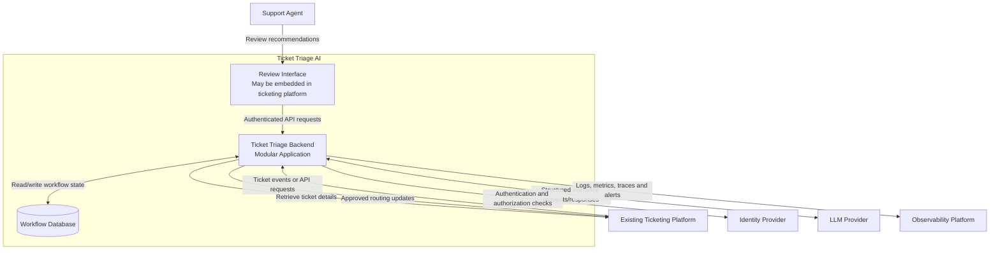

# Container Diagram — Ticket Triage AI

## 1. Purpose

This document describes the major runtime applications and data stores that make up the Ticket Triage AI system, their responsibilities, and how they communicate.

The diagram follows the C4 model's container level. Here, a *container* means a separately runnable application or data store, not necessarily a Docker container.

The design is provisional. Technology choices and deployment details will be finalized after the relevant requirements and constraints are validated.

## 2. Architecture Overview

The initial architecture consists of:

- **Ticketing Platform:** The existing external system that owns support tickets.
- **Support Agent Interface:** The interface agents use to review and approve recommendations. This may be part of the existing ticketing platform.
- **Ticket Triage Backend:** A modular application responsible for ingestion, classification, policy validation, approval workflow, and routing.
- **Workflow Database:** Persistent storage for recommendations, approval states, processing status, and audit references.
- **LLM Provider:** An external model service that generates structured classification recommendations.
- **Identity Provider:** The existing authentication and authorization service, if available.
- **Observability Platform:** External logging, metrics, and alerting infrastructure, if available.

The backend modules initially run within one application boundary. They are logical modules, not separate microservices.

## 3. Container Diagram

**Important:** The review interface can be integrated into the existing ticketing platform. The diagram does not require building a separate frontend application.

## 4. Container Responsibilities

### 4.1 Ticketing Platform

**Responsibility:** Remain the system of record for support tickets.

It provides ticket information and receives approved routing updates.

Key considerations:
- Integration may use webhooks, polling, or API requests.
- The backend must validate incoming events and requests.
- Routing updates must be protected against duplicate execution.
- The platform's API limits, authentication model, and retry behavior must be verified.

### 4.2 Review Interface

**Responsibility:** Allow authorized support staff to review AI recommendations.

The interface displays:
- Ticket reference and relevant ticket details.
- Recommended category, priority, and destination.
- A concise rationale for the recommendation.
- Validation warnings or missing information.
- Approve, correct, and reject actions.
- Processing and routing status.

The interface is not the security boundary. The backend must independently authenticate users, authorize actions, and verify that a recommendation is eligible for approval.

### 4.3 Ticket Triage Backend

**Responsibility:** Orchestrate the complete triage workflow.

The initial backend is a modular monolith containing these internal modules:

| Module | Responsibility |
|---|---|
| API and ingestion | Accept ticket events and validate requests |
| Normalization | Convert incoming tickets into a consistent internal representation |
| Classification | Request structured recommendations from the LLM |
| Policy and validation | Validate fields and enforce deterministic business rules |
| Approval workflow | Manage pending, approved, rejected, and corrected recommendations |
| Routing adapter | Execute authorized routing updates through the ticketing API |
| Audit and observability | Record decisions, outcomes, errors, and operational metrics |

Modules should communicate through explicit interfaces rather than directly sharing implementation details.

The backend remains responsible for the overall workflow. The LLM does not independently approve tickets or execute routing actions.

### 4.4 Workflow Database

**Responsibility:** Persist the state needed to operate the workflow reliably.

The data model should support:
- Ticket references and processing status.
- Recommendation versions and validated outputs.
- Approval decisions and the identity of the approver.
- Idempotency keys and processing attempts.
- Routing outcomes and reconciliation status.
- Audit references and timestamps.

Store only the ticket content and personal information needed for the approved workflow. Avoid duplicating sensitive ticket data unnecessarily.

The database technology is **not yet selected**. Choose it after evaluating consistency, transaction requirements, expected volume, operational capabilities, and deployment constraints.

### 4.5 LLM Provider

**Responsibility:** Generate a structured recommendation from the permitted ticket context.

The backend sends only the minimum information required for classification and expects a defined output schema.

The integration must handle:
- Timeouts and provider errors.
- Invalid or incomplete model responses.
- Rate limits and transient failures.
- Token usage and cost tracking.
- Prompt and model version tracking.
- Data retention and privacy requirements.

Model output is untrusted input. The backend must validate it before the recommendation can enter the approval workflow.

### 4.6 Identity Provider

**Responsibility:** Support authentication and, where applicable, identity and role information.

Authorization rules must determine who can review, approve, reject, correct, or configure triage policies.

If the existing ticketing platform already supplies suitable identity and authorization capabilities, a separate integration may not be necessary.

### 4.7 Observability Platform

**Responsibility:** Help operators understand system health and workflow outcomes.

Monitor:
- Ticket processing volume and latency.
- Classification failures and invalid outputs.
- Human approval and correction rates.
- Routing success and failure rates.
- LLM latency, token usage, and cost.
- Retry volume and unresolved workflow states.

Logs must avoid exposing unnecessary ticket content, credentials, or personal information.

## 5. Key Communication Paths

### Path A — Ticket Ingestion

1. The ticketing platform sends a ticket event or the backend retrieves the ticket.
2. The backend validates and normalizes the ticket.
3. The workflow state is recorded so processing can be tracked.

### Path B — Classification

1. The backend constructs a request using permitted ticket information.
2. The LLM returns a structured recommendation.
3. The backend validates the response.
4. Deterministic policy rules check the recommendation.
5. A valid recommendation is persisted as pending human approval.

If classification or validation fails, the ticket remains available for manual handling.

### Path C — Human Approval

1. The agent opens the recommendation.
2. The backend verifies the agent's identity and permissions.
3. The agent approves, corrects, or rejects the recommendation.
4. The backend persists the decision and its associated recommendation version.

### Path D — Routing

1. The backend verifies that the recommendation has an authorized approval.
2. It checks the workflow state and idempotency controls.
3. The routing adapter sends the update to the ticketing platform.
4. The backend records the outcome or marks it for reconciliation if the result is uncertain.

A timeout does not necessarily mean the external routing action failed. The backend must not blindly repeat a non-idempotent action when the first attempt's outcome is unknown.

## 6. Security and Trust Boundaries

The architecture must enforce these controls:

- **Inbound boundary:** Authenticate and validate ticket events and API requests.
- **Model boundary:** Treat ticket text and model output as untrusted data; minimize sensitive information sent externally.
- **Human approval boundary:** Verify authorization and approval state on the backend.
- **Outbound boundary:** Restrict ticketing API credentials and permit only intended operations.
- **Persistence boundary:** Apply appropriate access controls, encryption, retention, and audit policies.
- **Observability boundary:** Prevent secrets and unnecessary personal information from entering logs.

The exact controls depend on the selected ticketing platform, identity provider, hosting environment, and organizational policies.

## 7. Deployment Strategy

Start with one deployable backend application and one persistent workflow store, subject to validation of reliability and scale requirements.

Do not introduce separate services, a message broker, a vector database, or an agent framework without a demonstrated requirement.

Consider adding asynchronous workers or a durable queue later if measured workload, latency requirements, provider rate limits, or recovery needs justify them.

Deployment topology, database technology, queue requirements, and cloud provider remain open decisions.

## 8. Open Questions

| ID | Question | Why It Matters |
|---|---|---|
| CON-001 | Which ticketing platform is used? | Determines integration options |
| CON-002 | Does the platform support webhooks and idempotent updates? | Determines ingestion and recovery design |
| CON-003 | Can the review interface be embedded in the platform? | Determines frontend scope |
| CON-004 | Which LLM provider is permitted? | Determines integration and data controls |
| CON-005 | What identity and role system exists? | Determines approval authorization |
| CON-006 | What database and hosting services are available? | Determines deployment architecture |
| CON-007 | What are the retention and privacy requirements? | Determines data handling |
| CON-008 | What are the required throughput and latency targets? | Determines whether asynchronous processing is needed |

These questions must be resolved or explicitly accepted as assumptions before the architecture is finalized.

## 9. Exit Criteria

This document is ready for review when:

- The responsibilities of each container are understood.
- The ticket ingestion, classification, approval, and routing paths are clear.
- The modular monolith boundary is understood.
- Security and trust boundaries are documented.
- Unresolved technology choices are recorded rather than assumed.
- The architecture supports approval before routing and reliable recovery.

## 10. Next Document

Create `docs/03-system-design/data-model.md`.

That document will define the core entities, relationships, workflow states, and persistence requirements needed to support the architecture.
