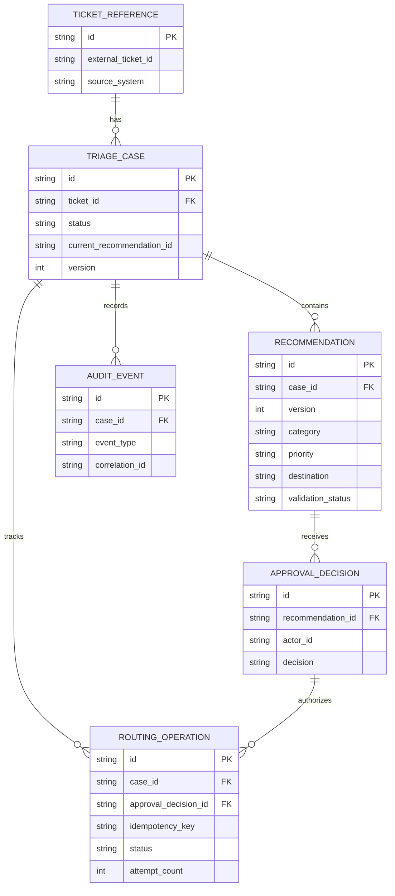

# Data Model — Ticket Triage AI

## 1. Purpose

This document defines the logical data model used by the Ticket Triage AI system.

It describes:
- The entities required to manage ticket triage.
- The relationships between entities.
- The lifecycle of a triage recommendation.
- The information that must be persisted for auditing and recovery.
- Data protection and consistency requirements.

This is a logical model, not a final database schema. Database technology and physical table definitions remain open decisions.

## 2. Design Principles

The data model follows these principles:

1. **Traceability:** Every recommendation must be associated with a ticket reference and processing attempt.
2. **Versioning:** Corrections and new recommendations must not silently overwrite previous decisions.
3. **Human accountability:** Approval records must identify the authorized actor and decision time.
4. **Reliable execution:** Routing operations must have trackable identifiers, statuses, and outcomes.
5. **Data minimization:** Store only the ticket content and personal information needed for the workflow.
6. **Consistency:** Invalid state transitions and duplicate routing actions must be prevented.
7. **Auditability:** Important decisions and state changes must be traceable.

## 3. Core Entities

### 3.1 Ticket Reference

Represents the external ticket being processed.

| Field | Description |
|---|---|
| `id` | Internal identifier |
| `external_ticket_id` | Ticket identifier in the source platform |
| `source_system` | Identifier for the ticketing platform |
| `created_at` | Time the record was created |
| `updated_at` | Time the record was last updated |

The external ticket remains the system of record for ticket content. The triage application should avoid copying the entire ticket unless required.

A unique constraint should prevent duplicate internal references for the same source system and external ticket ID.

### 3.2 Triage Case

Represents one triage workflow for a ticket.

| Field | Description |
|---|---|
| `id` | Unique triage case identifier |
| `ticket_id` | Reference to the ticket |
| `status` | Current workflow status |
| `current_recommendation_id` | Active recommendation, if any |
| `created_at` | Case creation time |
| `updated_at` | Last state change time |
| `version` | Version number used for concurrency control |

A ticket may have multiple triage cases over its lifetime if the business process permits re-triage. The exact uniqueness and re-triage rules must be confirmed.

### 3.3 Recommendation

Represents one version of the AI-generated or human-corrected triage result.

| Field | Description |
|---|---|
| `id` | Unique recommendation identifier |
| `case_id` | Parent triage case |
| `version` | Recommendation version |
| `category` | Recommended ticket category |
| `priority` | Recommended priority |
| `destination` | Recommended team or queue |
| `rationale` | Concise explanation for review |
| `model_provider` | Provider identifier |
| `model_version` | Model identifier or version, when available |
| `prompt_version` | Version of the classification instructions |
| `validation_status` | Result of deterministic output validation |
| `created_at` | Creation time |

Recommendations should be treated as versioned records. If an agent corrects a category or destination, preserve the original AI recommendation and record the correction as a new version or a separate human-decision record.

Do not treat model-generated confidence as a calibrated probability unless it has been explicitly evaluated and calibrated.

### 3.4 Approval Decision

Represents a human decision about a specific recommendation version.

| Field | Description |
|---|---|
| `id` | Unique decision identifier |
| `recommendation_id` | Recommendation being reviewed |
| `actor_id` | Authenticated user identifier |
| `decision` | `approved`, `corrected`, or `rejected` |
| `comment` | Optional review comment |
| `created_at` | Decision timestamp |

The backend must verify the actor's permissions and ensure the decision applies to the current eligible recommendation version.

An approval must not automatically authorize a different recommendation created afterward.

### 3.5 Routing Operation

Represents an attempt to apply an approved routing decision to the ticketing platform.

| Field | Description |
|---|---|
| `id` | Unique routing operation identifier |
| `case_id` | Related triage case |
| `approval_decision_id` | Authorizing decision |
| `idempotency_key` | Stable key used to prevent duplicate execution |
| `status` | Current execution status |
| `attempt_count` | Number of attempts |
| `external_operation_id` | External identifier, if provided |
| `last_error_code` | Sanitized error classification |
| `created_at` | Initial creation time |
| `updated_at` | Last status change time |

A routing operation must be associated with an eligible approval decision.

If an external request times out, the result may be unknown. The operation should be marked accordingly and reconciled before a potentially unsafe retry.

### 3.6 Audit Event

Represents an important workflow or security event.

| Field | Description |
|---|---|
| `id` | Unique event identifier |
| `case_id` | Related triage case, if applicable |
| `actor_type` | User, system, or integration |
| `actor_id` | Actor identifier, if applicable |
| `event_type` | Event classification |
| `entity_type` | Type of entity affected |
| `entity_id` | Identifier of the affected entity |
| `correlation_id` | Identifier linking related operations |
| `created_at` | Event timestamp |
| `metadata` | Restricted, structured event details |

Example event types include `ticket_received`, `recommendation_created`, `recommendation_rejected`, `approval_recorded`, `routing_started`, `routing_succeeded`, and `routing_outcome_unknown`.

Audit records should be append-oriented. Corrections should create new events rather than silently rewriting historical decisions.

Avoid storing full prompts, ticket contents, credentials, or sensitive personal information in audit metadata unless explicitly justified and protected.

## 4. Entity Relationships

The diagram expresses logical relationships. The final schema may add foreign keys, indexes, uniqueness constraints, and separate event storage according to the selected database.

## 5. Workflow States

The workflow case and the routing operation have different lifecycles. They should not share one status field.

### 5.1 Triage Case States

| State | Meaning |
|---|---|
| `received` | Ticket has been accepted for triage |
| `processing` | Validation or classification is in progress |
| `pending_approval` | A valid recommendation is awaiting human review |
| `approved` | An eligible recommendation has been approved |
| `rejected` | The recommendation or case was rejected |
| `routing` | An approved routing operation is being executed |
| `completed` | Routing has been confirmed successful |
| `manual_review` | Human handling is required due to an error or unresolved condition |

Allowed transitions must be explicitly implemented. For example, a rejected recommendation must not proceed directly to routing.

A later re-triage may create a new recommendation or case according to the business rules. It must not erase the original approval or routing history.

### 5.2 Routing Operation States

| State | Meaning |
|---|---|
| `pending` | Operation is recorded but has not started |
| `in_progress` | Request execution is underway |
| `succeeded` | The external routing update is confirmed |
| `failed` | The operation is known to have failed |
| `outcome_unknown` | The external action may have succeeded, but confirmation is missing |
| `reconciliation_required` | Additional verification is required before deciding what to do next |

An `outcome_unknown` operation must not be treated as a confirmed failure. Reconciliation should query the external system or use another reliable verification mechanism before retrying.

## 6. Example Workflow

Consider a ticket reporting that a customer cannot sign in.

1. The system creates a ticket reference and triage case.
2. The backend validates the incoming ticket.
3. The LLM recommends a category, priority, and destination.
4. The backend validates the output against the allowed schema and business rules.
5. The recommendation is saved as version 1.
6. The case enters `pending_approval`.
7. An authorized support agent reviews and approves version 1.
8. The approval decision is persisted.
9. A routing operation is created with an idempotency key.
10. The backend applies the approved routing update.
11. The operation is marked `succeeded` only after confirmation.
12. The case becomes `completed`, and audit events record the important transitions.

If the routing API times out after receiving the request, the routing operation becomes `outcome_unknown` or `reconciliation_required`. The system verifies the external outcome before attempting another update.

## 7. Data Integrity Rules

The implementation must enforce these rules:

- External ticket references are unique within a source system.
- Recommendation versions are unique within a triage case.
- Approval decisions reference existing recommendation versions.
- Only authorized actors can approve recommendations.
- Routing operations require an eligible approval decision.
- Routing operation idempotency keys are unique within the appropriate scope.
- Completed cases have a confirmed successful routing outcome when routing is required.
- State transitions are validated by the backend.
- Concurrent approval or routing requests cannot bypass state checks.
- Important state changes generate audit events.

Use database transactions or equivalent consistency controls where multiple related records must change together.

## 8. Data Retention and Privacy

Before implementation, define:

- Which ticket fields may be persisted.
- Whether ticket text may be sent to the selected LLM provider.
- Retention periods for recommendations, approvals, and audit events.
- Rules for deleting or anonymizing personal information.
- Encryption requirements for data at rest and in transit.
- Access controls for audit records and operational logs.
- Whether model-provider requests and responses are retained externally.

The application should store references and decision metadata whenever these are sufficient instead of duplicating entire tickets.

## 9. Open Questions

| ID | Question | Impact |
|---|---|---|
| DATA-001 | Can a ticket have multiple triage cases? | Determines uniqueness rules |
| DATA-002 | How should re-triage be represented? | Determines versioning and lifecycle |
| DATA-003 | Which categories, priorities, and destinations are allowed? | Determines validation rules |
| DATA-004 | What ticket fields may be stored or sent to the LLM? | Determines privacy controls |
| DATA-005 | What retention policies apply? | Determines lifecycle and deletion behavior |
| DATA-006 | Can the ticketing platform verify routing outcomes? | Determines reconciliation strategy |
| DATA-007 | Which database is available? | Determines physical schema and transactions |

## 10. Exit Criteria

The data model is ready for review when:

- Core entities and relationships are understood.
- Case and routing-operation lifecycles are separate.
- Approval and routing authorization rules are explicit.
- Versioning, idempotency, and audit requirements are covered.
- Privacy and retention questions are documented.
- Open business rules are identified rather than assumed.

## 11. Next Document

Create `docs/03-system-design/api-contracts.md`.

That document will define the backend API endpoints, request and response schemas, error behavior, and authorization requirements for submitting tickets, reviewing recommendations, recording decisions, and tracking routing outcomes.
