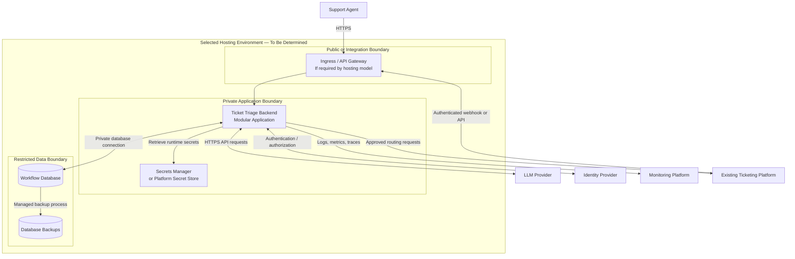

# Deployment Architecture — Ticket Triage AI

## 1. Purpose

This document defines the proposed deployment architecture for the Ticket Triage AI system.

It covers:
- Runtime environments and deployment boundaries.
- Network communication and access controls.
- Configuration and secrets management.
- Scaling and availability.
- Health checks, monitoring, and deployment safety.
- Backup, recovery, and operational considerations.

The design is provisional. Cloud provider, compute platform, database technology, and deployment tooling must be selected based on validated requirements and organizational constraints.

## 2. Deployment Principles

The deployment architecture follows these principles:

1. **Simplicity:** Begin with a small number of deployable components.
2. **Security:** Apply least privilege and minimize public exposure.
3. **Reliability:** Persist workflow state and handle external failures explicitly.
4. **Observability:** Collect operational metrics, logs, and traces.
5. **Reproducibility:** Automate build, test, and deployment processes.
6. **Configuration separation:** Keep environment-specific configuration outside application code.
7. **Controlled releases:** Support health checks, rollback, and database migration management.
8. **Cost awareness:** Measure resource use and model costs before adding infrastructure.

## 3. Proposed Deployment Topology

The initial deployment contains one backend application and one persistent database. The ticketing platform, LLM provider, identity provider, and monitoring platform remain external dependencies.

The diagram represents logical security boundaries, not a commitment to a specific cloud architecture. Some managed hosting platforms provide ingress, secret storage, backups, and monitoring as built-in services.

## 4. Deployment Components

### 4.1 Ingress or API Gateway

**Responsibility:** Provide a controlled entry point for supported inbound requests.

Possible capabilities:
- TLS termination and HTTPS enforcement.
- Request-size and rate limits.
- Routing requests to the backend.
- Integration with authentication controls.
- Request correlation and access logging.

A separate API gateway is not mandatory for the initial deployment. Use the hosting platform's built-in ingress when it satisfies the requirements.

The backend must still enforce authorization and validate requests.

### 4.2 Ticket Triage Backend

**Responsibility:** Execute the triage workflow.

The backend contains the internal modules defined in the system design:
- Ingestion and normalization.
- Classification.
- Policy validation.
- Approval workflow.
- Routing adapter.
- Audit and observability.

The initial deployment runs these modules as one application. Multiple application instances may be deployed if needed, provided that shared state and concurrent operations are handled correctly.

The application should be stateless with respect to durable workflow state: critical case and routing state belongs in persistent storage rather than process memory.

### 4.3 Workflow Database

**Responsibility:** Persist cases, recommendations, decisions, routing operations, and required audit records.

Deployment requirements:
- Restrict network access to authorized application identities.
- Require encrypted connections.
- Enable appropriate encryption at rest.
- Configure backups and test restoration.
- Monitor connection pools, storage capacity, and query performance.
- Apply schema migrations through a controlled release process.

The database engine and hosting model remain undecided.

### 4.4 Secrets Manager

**Responsibility:** Store and supply sensitive runtime credentials.

Examples include:
- LLM provider API keys.
- Ticketing platform credentials.
- Database credentials, if applicable.
- Webhook verification secrets.

Secrets must not be committed to source control, embedded in container images, or printed in logs.

Prefer workload identities or short-lived credentials when supported by the selected platform. Restrict secret access to the components that need each secret.

### 4.5 External Dependencies

The application communicates with:
- The ticketing platform for ticket retrieval and routing updates.
- The LLM provider for classification.
- The identity provider for authentication and authorization, when applicable.
- The observability platform for operational telemetry.

Outbound network access should be restricted to required destinations where the hosting environment supports this control.

## 5. Environments

Use separate environments to reduce the risk of development changes affecting production.

| Environment | Purpose | Data and Access |
|---|---|---|
| Local | Development and unit testing | Synthetic or sanitized test data |
| Test / CI | Automated tests and integration checks | Controlled test data and test credentials |
| Staging | Production-like validation | Non-production credentials and approved test data |
| Production | Real ticket processing | Restricted access and approved operational controls |

Environment-specific configuration must be explicit. Staging and production should not share application secrets or databases.

Production access should be limited to authorized personnel and audited.

## 6. Network and Security Design

### 6.1 Inbound Traffic

- Require HTTPS for externally accessible endpoints.
- Authenticate ticketing-platform events and integration requests.
- Apply request validation, payload limits, and rate limiting.
- Prevent direct database access from public networks.
- Restrict administrative endpoints to authorized identities.

### 6.2 Outbound Traffic

The backend needs outbound connectivity to selected external dependencies.

- Use TLS for external API requests.
- Store integration credentials in a secret store.
- Set connection and request timeouts.
- Apply bounded retries for eligible transient errors.
- Prevent redirects or configuration changes from silently sending sensitive ticket data to unapproved destinations.

### 6.3 Data Protection

- Send only approved ticket fields to the LLM provider.
- Define retention requirements for ticket references, recommendations, and audit records.
- Avoid logging raw ticket text by default.
- Restrict access to operational and audit data.
- Apply encryption in transit and at rest according to the organization's requirements.

The hosting provider and LLM provider must be evaluated against applicable privacy, contractual, and data-residency requirements before production deployment.

## 7. Configuration Management

Configuration should be externalized from application code.

Examples include:

| Configuration | Examples |
|---|---|
| Application | Log level, request timeout |
| Classification | Model identifier, prompt version |
| Policy | Allowed categories, priorities, destinations |
| Reliability | Retry limits, circuit-breaker settings |
| Integration | API base URLs, connection timeouts |
| Operations | Metrics settings, health-check intervals |

Separate non-sensitive configuration from secrets.

Changes to categories, priorities, and routing rules should be validated and auditable. Avoid allowing arbitrary configuration changes to bypass policy validation or approval requirements.

Record the effective model and prompt versions used for each recommendation when these details are available.

## 8. Scaling Strategy

Start by measuring actual workload and latency. The initial estimate of 1,000–10,000 tickets per day must be validated.

A reasonable progression is:

### Step 1 — Single Application Instance

Use one backend instance during early development and limited testing.

This minimizes operational complexity but does not provide application-level redundancy.

### Step 2 — Multiple Backend Instances

Add instances when availability or throughput requires them.

Before scaling horizontally:
- Persist workflow state in shared storage.
- Handle concurrent updates with transactions or optimistic concurrency.
- Make duplicate event handling safe.
- Ensure routing operations are coordinated across instances.
- Avoid relying on in-memory locks or state for correctness.

### Step 3 — Asynchronous Processing

Consider a durable queue and worker processes when measured requirements justify them, such as:
- Large bursts of ticket events.
- Slow or rate-limited LLM requests.
- Independent scaling of ingestion and classification.
- Stronger buffering and recovery requirements.

A queue introduces additional operational responsibilities, including delivery guarantees, duplicate handling, dead-letter processing, and monitoring. It should not be added without a clear benefit.

## 9. Availability and Failure Recovery

The application must expect failures in external services and its own infrastructure.

| Failure | Expected Behavior |
|---|---|
| LLM timeout | Apply bounded retry rules where safe; otherwise route to manual review |
| Invalid model response | Reject the response and record a controlled failure |
| Ticketing API unavailable | Preserve the workflow state and defer or reconcile the operation |
| Database unavailable | Fail safely; do not claim durable acceptance without persistence |
| Application restart | Recover pending work from persistent state |
| Network timeout during routing | Mark the outcome unresolved until verified |
| Invalid configuration | Fail startup or reject the configuration change safely |
| Credential expiration | Alert operators and use the approved credential-refresh process |

A routing operation must not be repeated blindly if the external result is unknown. Use platform-supported idempotency, operation lookup, or reconciliation to establish the outcome.

Manual handling must remain available when automated processing cannot proceed safely.

## 10. Observability and Health Checks

Monitor system health and business outcomes separately.

### Infrastructure and Application Metrics

- Application availability and error rate.
- Request latency and throughput.
- Database connection and query health.
- CPU, memory, and storage consumption.
- External dependency latency and failures.
- LLM token usage and request cost.

### Workflow Metrics

- Tickets received and processed.
- Recommendations generated and invalid responses rejected.
- Cases awaiting human review.
- Approval, correction, and rejection rates.
- Routing success, failure, and unresolved outcomes.
- Time spent in each workflow state.
- Number and age of cases requiring manual handling.

### Health Endpoints

Consider:
- **Liveness:** Whether the application process is functioning.
- **Readiness:** Whether the application can accept its intended workload.
- **Dependency health:** Whether required dependencies are available, reported separately where practical.

A temporary LLM outage should not necessarily cause the process to be restarted repeatedly. Health checks must distinguish application failure from external dependency failure.

## 11. Backup, Recovery, and Deployment Safety

Define recovery objectives before production.

- **RPO (Recovery Point Objective):** Maximum acceptable data loss.
- **RTO (Recovery Time Objective):** Maximum acceptable recovery duration.

The required values depend on business impact and have not yet been agreed.

Required practices:
- Configure database backups.
- Test restoration periodically.
- Keep deployment configuration and infrastructure definitions version-controlled.
- Run automated tests before release.
- Use controlled database migrations.
- Verify health and key workflow metrics after deployment.
- Maintain a rollback or recovery procedure.
- Ensure deployments do not invalidate pending approvals or routing operations.

A rollback of application code must not erase or misinterpret workflow state created by a newer version.

## 12. Deployment Automation

A future CI/CD pipeline should perform these stages:

1. Check formatting and static analysis.
2. Run unit tests.
3. Run API contract and integration tests.
4. Run security and dependency checks.
5. Build a versioned application artifact.
6. Deploy to a non-production environment.
7. Run smoke tests.
8. Require any necessary production approval.
9. Deploy to production.
10. Verify health, workflow metrics, and rollback conditions.

Production deployment must not automatically grant permission to route tickets or weaken approval rules.

Infrastructure-as-code may be introduced when the hosting platform and deployment requirements are selected.

## 13. Open Questions

| ID | Question | Impact |
|---|---|---|
| DEP-001 | Which cloud or hosting environment is approved? | Determines deployment services |
| DEP-002 | What availability target is required? | Determines redundancy and failover |
| DEP-003 | What are the RPO and RTO requirements? | Determines backup and recovery design |
| DEP-004 | Which database service is available? | Determines persistence operations |
| DEP-005 | Are public inbound endpoints permitted? | Determines integration connectivity |
| DEP-006 | What data-residency and privacy controls apply? | Determines provider and region selection |
| DEP-007 | What is the validated peak ticket rate? | Determines scaling approach |
| DEP-008 | Is a durable queue required? | Determines asynchronous processing architecture |
| DEP-009 | Which CI/CD and monitoring platforms are available? | Determines operational tooling |

## 14. Exit Criteria

This document is ready for review when:
- Deployment boundaries are clear.
- Network access and secrets management are addressed.
- Environment separation is defined.
- Scaling and failure recovery strategies are documented.
- Backup and recovery objectives are identified.
- Deployment automation and observability requirements are understood.
- Unresolved technology decisions are recorded.

## 15. Next Document

Create `docs/03-system-design/failure-handling.md`.

That document will define the failure scenarios, retry policies, timeout behavior, idempotency rules, reconciliation procedures, and manual fallback paths that keep the triage workflow safe when dependencies fail.
