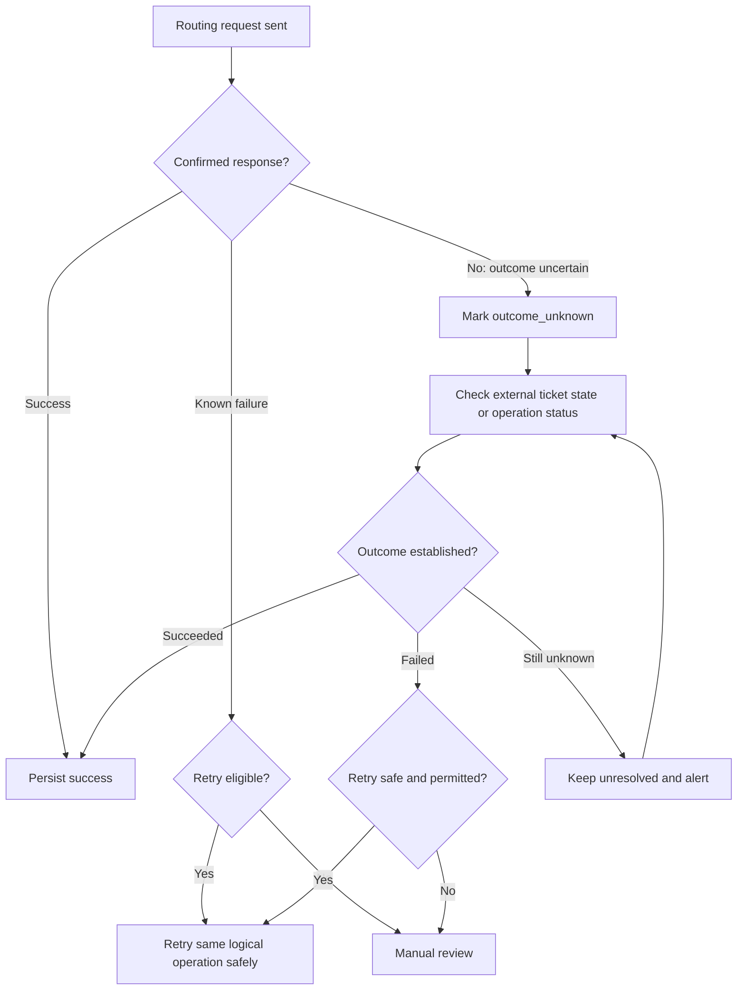

# Failure Handling — Ticket Triage AI

## 1. Purpose

This document defines failure-handling and recovery strategies for the Ticket Triage AI system.

It covers:
- Failure detection and classification.
- Timeouts and retry policies.
- Idempotency and duplicate-event handling.
- Recovery of interrupted workflows.
- Routing reconciliation.
- Human fallback procedures.
- Logging, alerting, and operational ownership.

The design is technology-neutral. Specific timeout values, retry limits, and recovery objectives must be validated through testing and operational requirements.

## 2. Core Principles

1. **Fail safely:** An error must not bypass validation, authorization, or human approval.
2. **Preserve state:** Persist important workflow transitions so processing can resume after a restart.
3. **Distinguish failure from uncertainty:** A timeout does not prove that an external operation failed.
4. **Retry selectively:** Retry only errors that are transient and operations that are safe to repeat.
5. **Prevent duplicate effects:** Use idempotency controls and reconciliation.
6. **Provide manual fallback:** Tickets must remain available for human handling when automation cannot proceed.
7. **Make failures observable:** Record sanitized error details and expose actionable metrics.
8. **Avoid retry storms:** Use bounded attempts, backoff, and rate limits.
9. **Maintain auditability:** Preserve the history of attempts, decisions, and recovery actions.

## 3. Failure Categories

| Category | Examples | Default Response |
|---|---|---|
| Input failure | Missing subject, malformed payload | Reject or request correction |
| Classification failure | LLM timeout, invalid JSON | Bounded retry where appropriate; otherwise manual review |
| Policy failure | Invalid category or priority | Reject recommendation; do not route |
| Authorization failure | Unauthorized approval attempt | Reject request and record a security event |
| Persistence failure | Database unavailable | Do not claim durable acceptance |
| Integration failure | Ticketing API unavailable | Preserve state and defer or reconcile |
| Concurrency failure | Two reviewers act on the same version | Reject stale or conflicting action |
| Operational failure | Application crash or deployment interruption | Recover from persisted state |
| Configuration failure | Invalid destination or missing credential | Fail safely and alert operators |

## 4. Failure Handling by Workflow Stage

### 4.1 Ticket Ingestion

**Possible failures**
- Malformed ticket event.
- Missing required fields.
- Duplicate webhook delivery.
- Authentication or signature validation failure.
- Database unavailable while accepting the event.

**Handling**
1. Authenticate the sender before processing trusted integration events.
2. Validate the payload and enforce size limits.
3. Normalize the ticket and check required fields.
4. Deduplicate using the source system and external event or ticket identifier.
5. Persist the case before acknowledging durable acceptance.
6. Record a safe, actionable error when validation fails.

If the database is unavailable, the system must not report that a ticket has been durably accepted unless another approved durable mechanism has stored it.

A duplicate event should not create a second active workflow or trigger a second routing operation.

### 4.2 Classification

**Possible failures**
- LLM request timeout.
- Rate limiting.
- Provider outage.
- Malformed or incomplete response.
- Unsupported category or priority.
- Output that violates deterministic policy.

**Handling**
1. Apply a configured request timeout.
2. Retry eligible transient failures within a bounded budget.
3. Validate the response schema and required fields.
4. Validate category, priority, and destination against the current policy.
5. Persist valid recommendations before presenting them for approval.
6. Move exhausted or invalid cases to manual review.

The LLM must never select an arbitrary routing destination and cause the system to execute it without policy validation and human approval.

### 4.3 Human Approval

**Possible failures**
- Reviewer session expires.
- Reviewer lacks permission.
- Recommendation changes while the review page is open.
- Two reviewers submit conflicting decisions.
- The approval request times out after the server commits it.

**Handling**
- Reauthenticate when required.
- Verify reviewer authorization on the server.
- Check the current recommendation version and case state.
- Use a transaction or equivalent concurrency control to prevent conflicting decisions.
- Make decision submission idempotent where retries are possible.
- Allow the reviewer to retrieve the persisted decision after an uncertain response.

A frontend confirmation is not authoritative. The persisted backend decision is the source of truth.

### 4.4 Routing

**Possible failures**
- Ticketing API returns a known failure.
- Authentication to the ticketing platform expires.
- A request times out after the platform may have applied the change.
- The platform accepts a request but the response is lost.
- Another actor changes the ticket concurrently.

**Handling**
1. Verify the persisted approval and its recommendation version.
2. Create or retrieve the corresponding routing operation.
3. Persist the operation state and stable idempotency key.
4. Execute the external request.
5. Record a confirmed success or known failure.
6. If the outcome is uncertain, mark it `outcome_unknown` and begin reconciliation.
7. Escalate unresolved cases to manual handling.

Never create a new logical routing operation simply because the response to an earlier request was lost.

## 5. Retry Policy

Retries are appropriate only when the failure may be transient and the operation is safe to repeat.

### 5.1 Retry Classification

| Failure | Retry? | Notes |
|---|---|---|
| Invalid request | No | Correct the input first |
| Invalid model output | Not automatically by default | A bounded re-request may be considered, but repeated invalid output must end in fallback |
| LLM rate limit | Usually | Respect provider guidance and rate-limit headers |
| LLM timeout | Sometimes | Bound attempts and total elapsed time |
| Database transaction conflict | Sometimes | Retry a fresh transaction when safe |
| Database unavailable | Sometimes | Retry with backoff; preserve durable state |
| Authentication failure | Not blindly | Investigate expired or invalid credentials |
| Authorization denial | No | Requires a legitimate permission change |
| Ticketing API validation error | No | Correct the request or policy |
| Ticketing API timeout | Not blindly | Verify the external outcome before retrying |
| Routing outcome unknown | Reconcile first | Prevent duplicate external effects |

### 5.2 Exponential Backoff

For eligible transient failures, use bounded exponential backoff with jitter.

A common model is:

\[
d_n = \min(d_{\max}, d_0 \times 2^n) + J
\]

Where:
- \(d_n\) is the delay before attempt \(n\).
- \(d_0\) is the initial delay.
- \(d_{\max}\) is the maximum backoff.
- \(J\) is a random jitter value.

These parameters must be configured for the dependency and workload. Respect provider-specified retry delays when applicable.

A retry policy must also define:
- Maximum attempts.
- Maximum total elapsed time.
- Which error codes are eligible.
- Whether the operation is idempotent.
- What happens when the retry budget is exhausted.

Do not retry indefinitely.

## 6. Idempotency and Duplicate Prevention

An operation is idempotent when repeating it produces the same intended effect as executing it once.

The system needs separate controls for separate operations.

### 6.1 Ticket Ingestion

Use a stable source identity, such as:

`source_system + external_ticket_id + event_identity`

If the source does not provide a stable event identity, define an explicit deduplication policy appropriate to its delivery semantics.

### 6.2 Approval Decisions

Associate the decision with:
- The triage case.
- The recommendation identifier and version.
- The authenticated actor.
- The decision submission or idempotency identifier, where applicable.

A repeated request should return or expose the existing result when it is the same logical operation. A conflicting decision must not overwrite a committed decision silently.

### 6.3 Routing Operations

Each logical routing operation must have a stable identifier and idempotency key.

Before repeating a routing request:
1. Check the persisted operation state.
2. Query the external platform if it supports reliable operation lookup.
3. Verify whether the intended update already occurred.
4. Retry only when the result is known or the operation is demonstrably safe to repeat.

An idempotency key in the local database does not automatically make an external API idempotent. The target platform must support the required semantics, or the integration must implement a safe reconciliation strategy.

## 7. Routing Reconciliation

Reconciliation resolves cases where the local system cannot determine whether a routing update succeeded.

### Reconciliation Workflow

Reconciliation may be automated or operator-assisted, depending on the ticketing platform's capabilities.

The process must not mark an operation successful merely because the request was sent, nor failed merely because the response timed out.

## 8. Workflow Recovery

The backend must be able to recover after a process restart or deployment interruption.

At startup or through a controlled recovery worker:

1. Identify cases left in transitional states.
2. Load persisted case and operation state.
3. Distinguish work that was never started from work that may have executed externally.
4. Resume safe internal processing.
5. Reconcile uncertain external operations.
6. Escalate records that exceed configured recovery limits.
7. Record recovery actions in the audit trail.

Do not rely solely on in-memory task state for important work.

If asynchronous processing is introduced later, the recovery design must also account for message redelivery, duplicate delivery, and dead-letter handling.

## 9. Manual Fallback

Manual fallback is required when automated processing cannot safely continue.

Examples include:
- Repeated LLM failures.
- Invalid model responses.
- Policy validation failures.
- Unresolved routing outcomes.
- Missing integration permissions.
- Persistent database or platform outages.

The fallback workflow should:
- Keep the ticket accessible in the source platform.
- Clearly indicate that automated triage did not complete.
- Explain the failure using a safe, understandable status or error category.
- Avoid presenting an unvalidated recommendation as approved.
- Allow an authorized operator to investigate and resolve the case.
- Record the manual action and final outcome.

Manual fallback must not require the operator to trust an uncertain routing status.

## 10. State Transitions During Failure

Failure handling must preserve valid workflow states.

| Current State | Event | Result |
|---|---|---|
| `received` | Input validated | `processing` |
| `received` | Input invalid | Rejected or manual handling according to policy |
| `processing` | Valid recommendation created | `pending_approval` |
| `processing` | Retry budget exhausted | `manual_review` |
| `pending_approval` | Authorized approval recorded | `approved` |
| `pending_approval` | Recommendation rejected | `rejected` |
| `approved` | Routing operation starts | `routing` |
| `routing` | Routing confirmed successful | `completed` |
| `routing` | Routing outcome uncertain | `manual_review` or a defined unresolved state |
| Any eligible state | Recovery initiated | Transition according to validated recovery rules |

The case status model must remain consistent with the routing-operation status model defined in `data-model.md`.

For production, consider representing unresolved routing explicitly at the case level instead of overloading `manual_review`. Whichever representation is chosen must distinguish “known failure” from “outcome unknown.”

## 11. Observability and Alerts

Track failures by dependency, error category, workflow stage, and severity.

Recommended metrics:
- LLM timeout and invalid-output rates.
- Ticketing API error and timeout rates.
- Database transaction failures.
- Retry attempts and exhausted retry budgets.
- Duplicate events detected.
- Cases awaiting manual review.
- Routing operations in `outcome_unknown`.
- Age of unresolved operations.
- Time required to reconcile routing outcomes.

Recommended alerts:
- Sustained dependency outage.
- Increase in invalid model outputs.
- Growing backlog of pending approvals.
- Routing failure rate above the agreed threshold.
- Any unresolved routing operation older than its operational deadline.
- Unexpected authentication or authorization failures.
- Database capacity or backup failures.

Alert thresholds and response ownership must be defined with the operational team.

## 12. Security Considerations

- Do not include secrets or full sensitive ticket content in error messages.
- Treat ticket text and model output as untrusted input.
- Do not weaken authorization during recovery.
- Require appropriate permissions for manual overrides.
- Audit retries, reconciliation, and administrative actions.
- Prevent duplicate approval or routing actions.
- Restrict access to diagnostic information.
- Ensure recovery tooling cannot bypass approval requirements.

## 13. Open Questions

| ID | Question | Impact |
|---|---|---|
| FAIL-001 | Which ticketing operations are idempotent? | Determines safe routing retries |
| FAIL-002 | Can the platform query the result of a prior update? | Determines reconciliation design |
| FAIL-003 | What retry limits and timeouts are acceptable? | Determines recovery latency |
| FAIL-004 | Who owns manual review and unresolved operations? | Determines escalation workflow |
| FAIL-005 | What are the operational alert thresholds? | Determines monitoring configuration |
| FAIL-006 | What recovery objectives are required? | Determines persistence and recovery strategy |
| FAIL-007 | How should the case represent an unresolved routing outcome? | Determines state-machine design |

## 14. Exit Criteria

This document is ready for review when:
- Failure scenarios have explicit handling rules.
- Retry eligibility and limits are defined.
- Duplicate effects are addressed.
- Routing uncertainty is distinguished from known failure.
- Recovery and reconciliation procedures are documented.
- Manual fallback has an owner and a defined workflow.
- Monitoring and escalation requirements are recorded.

## 15. Next Step

Review the complete `docs/03-system-design/` directory and verify that the documents agree on component boundaries, entity names, API contracts, and workflow states.

Then update `docs/03-system-design/README.md` to mark the completed documents as drafted and identify unresolved design decisions before moving to implementation planning.
