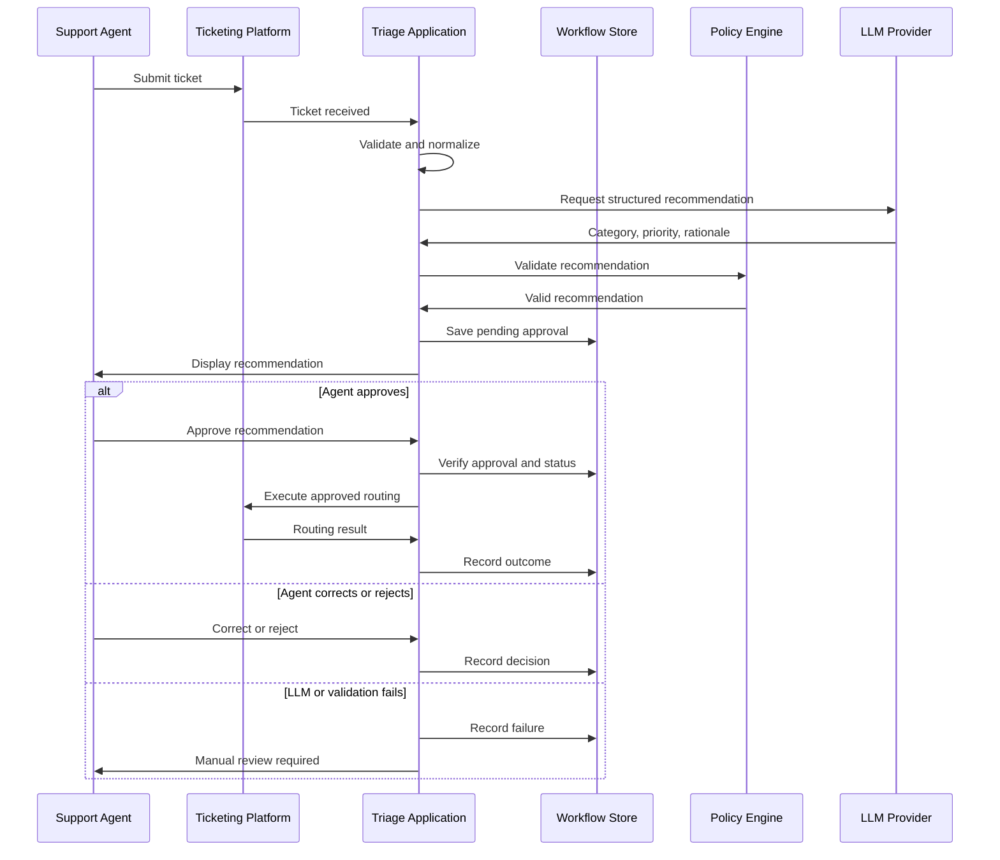

# Sequence Diagram — Ticket Triage Workflow

This diagram documents the normal flow and the key failure paths.



The diagram introduces a workflow store because approval can happen later than the initial recommendation. The application needs a reliable way to remember the ticket, recommendation, status, and approval decision between those steps.

## Workflow State Machine

A workflow state machine prevents invalid transitions.

```text
RECEIVED
    │
    ▼
PROCESSING
    │
    ▼
PENDING_APPROVAL
    │
    ├──────────────► APPROVED ──► ROUTED
    │
    └──────────────► REJECTED ──► No routing action
```

Errors can transition to `RETRY_PENDING` or `MANUAL_REVIEW`, according to the failure policy.

### Design considerations

- Approval must be associated with the exact recommendation being approved.
- A correction should invalidate the old approval if it changes the proposed action.
- Duplicate approval or routing requests must not cause duplicate side effects.
- A routing timeout can leave the outcome uncertain; reconcile with the ticketing platform before blindly retrying.
- Terminal states and retry transitions should be explicitly defined.
