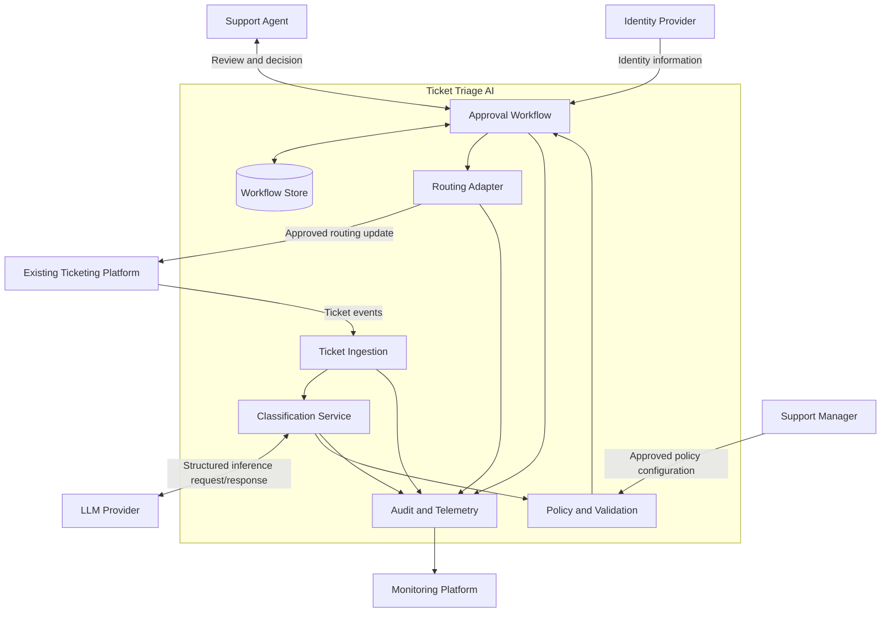

# System Context — Ticket Triage AI

**Project:** Ticket Triage AI  
**Phase:** 03 — System Design  
**Status:** Draft — Pending Validation  
**Document ID:** SD-001

## 1. Purpose

Define the system boundary, external actors, dependencies, and interactions for the Ticket Triage AI platform.

This document establishes the context for the component architecture, API contracts, data model, and deployment design.

## 2. System Overview

Ticket Triage AI assists support teams by analyzing incoming support tickets and recommending:

- A ticket category.
- A priority level.
- A destination support team.
- A concise rationale for the recommendation.

An authorized human reviews the recommendation and approves, corrects, or rejects it.

The system executes a routing action only after verifying that the required approval exists and remains valid.

The LLM is responsible for generating recommendations. Application logic is responsible for validation, policy enforcement, authorization, workflow state, and execution control.

## 3. System Boundary

### Inside the system

The Ticket Triage AI platform owns:

- Ticket ingestion and normalization.
- Classification requests and response handling.
- Recommendation validation.
- Deterministic business rules.
- Approval workflow management.
- Workflow state persistence.
- Approval-gated routing orchestration.
- Ticketing integration logic.
- Audit events and operational telemetry.
- Failure recovery and manual fallback coordination.

### Outside the system

The following are external dependencies or actors:

- Existing ticketing platform.
- Human support agents and approvers.
- External LLM provider, if one is selected.
- Identity provider, if the organization uses one.
- Monitoring or alerting infrastructure, if provided externally.

The final boundary depends on the organization's actual systems and deployment constraints.

## 4. External Actors and Systems

| Actor or system | Type | Responsibility | Interaction |
|---|---|---|---|
| Support Agent | Human actor | Reviews and corrects recommendations | Uses the review interface |
| Support Manager | Human actor | Defines categories, priorities, and routing policies | Provides configuration and operational decisions |
| Ticketing Platform | External system | Stores tickets and applies approved routing changes | Sends ticket events and receives approved updates |
| LLM Provider | External system | Generates structured recommendations | Receives permitted ticket context and returns a recommendation |
| Identity Provider | External system, if applicable | Authenticates users and provides identity information | Supports authentication and authorization |
| Monitoring Platform | External system, if applicable | Receives operational telemetry and alerts | Collects metrics, logs, and traces |

## 5. System Context Diagram

The diagram is conceptual. It does not imply that every component must be a separate service or that the named external systems have already been selected.

## 6. Primary Interactions

### 6.1 Ticket Submission

1. The ticketing platform creates or updates a ticket.
2. The platform sends a supported event or the application retrieves the ticket.
3. The ingestion layer validates the incoming data.
4. The application records the processing state and normalizes the ticket.

**Expected outcome:** A valid ticket is ready for classification, or an invalid ticket is handled according to the defined error policy.

### 6.2 Recommendation Generation

1. The classification service prepares the permitted ticket context.
2. The LLM generates a structured recommendation.
3. The application validates the response schema and allowed values.
4. The policy engine applies deterministic routing and escalation rules.
5. The application stores the recommendation with a pending-approval status.

**Expected outcome:** A valid recommendation is available for human review.

### 6.3 Human Approval

1. An authenticated reviewer opens the recommendation.
2. The application verifies that the reviewer has permission to act.
3. The reviewer approves, corrects, or rejects the recommendation.
4. The application records the decision and updates the workflow state.
5. If the decision authorizes routing, the application permits the routing workflow to continue.

**Expected outcome:** The decision is recorded and unauthorized actions are prevented.

### 6.4 Routing Execution

1. The routing workflow verifies the approval and current ticket state.
2. The routing adapter sends the approved update to the ticketing platform.
3. The adapter records the result or marks the outcome as uncertain if confirmation is unavailable.
4. Failed or uncertain outcomes enter the defined recovery process.

**Expected outcome:** The system records a confirmed routing result or an explicit unresolved state.

## 7. Trust Boundaries

The architecture must account for several distinct trust boundaries.

### 7.1 Ticketing Platform to Application

Ticket content is external input. Validate fields, sizes, identifiers, and supported values before processing.

### 7.2 Application to LLM Provider

Ticket text may contain sensitive information or untrusted instructions.

The application must:
- Send only approved data.
- Apply required redaction or minimization.
- Treat ticket content as data, not as instructions to override system policy.
- Treat model output as untrusted until validated.

### 7.3 Human Review Interface

The system must authenticate users, enforce authorization, and prevent unauthorized approval or modification.

### 7.4 Application to Ticketing Platform

Routing is a consequential action. The integration must verify approval, enforce current-state checks, use safe retry behavior, and record the outcome.

## 8. Assumptions and Open Questions

| ID | Question | Required evidence |
|---|---|---|
| CTX-001 | Which ticketing platform is used? | Stakeholder confirmation and integration documentation |
| CTX-002 | Does the platform support webhooks or event subscriptions? | API documentation or proof of concept |
| CTX-003 | Which LLM providers are permitted? | Security and privacy approval |
| CTX-004 | Which authentication mechanism is required? | Identity and security requirements |
| CTX-005 | Where must workflow state and audit data be stored? | Retention, availability, and data-residency requirements |
| CTX-006 | Which monitoring tools are available? | Platform engineering review |
| CTX-007 | Can routing requests be safely retried? | Ticketing API semantics and idempotency documentation |
| CTX-008 | What is the manual fallback process? | Support operations agreement |

## 9. Architecture Implications

The context establishes the following design requirements:

1. The ticketing platform must be accessed through a dedicated integration boundary.
2. LLM inference must be isolated from mandatory policy enforcement.
3. The approval workflow must persist across requests and application restarts.
4. The routing adapter must not rely solely on the review interface to enforce approval.
5. Identity and authorization checks must be performed by trusted application components.
6. External dependency failures must not be mistaken for successful processing.
7. Sensitive ticket data must not be indiscriminately copied into logs or telemetry.

## 10. Exit Criteria

- [ ] The system boundary has been reviewed.
- [ ] External actors and systems have been identified.
- [ ] Primary interactions are documented.
- [ ] Trust boundaries and sensitive data flows are identified.
- [ ] The ticketing platform and available integration mechanisms are confirmed.
- [ ] Open questions have owners or explicit next actions.
- [ ] The context is consistent with the functional and non-functional requirements.

## 11. Next Document

**`container-diagram.md`**

The next document will refine this system context into the major runtime applications, data stores, external dependencies, and communication paths. It will also distinguish logical components from deployable containers.
